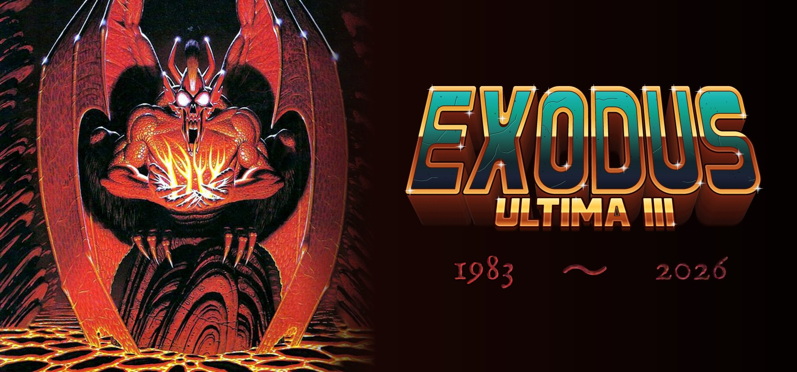

# Ultima III in the browser: developer notes



A TypeScript port of LairWare's Macintosh remake of Ultima III (the C sources
in `../Lairware/Sources`). It displays the pixel screen with Three.js and plays
sound and music with Web Audio. What the game is and what changed for
the player is in the [root README](../README.md); this file is about the
code.

## Running it

```sh
cd web
npm install
npm run extract   # converts ../Resources and ../Images into public/
npm run dev       # http://localhost:5173
npm test          # unit tests (Vitest, run in Node)
npm run build     # typecheck + production build into dist/
npm run figures   # writes art/figures/ into the Standard tile sheet
npm run saves     # writes ../showcase/, the showcase saves (tools/saves/showcase.ts)
npm run fuzz      # the game played headless at random, checked after every key (tools/sim/fuzz.ts)
```

The last Help page in the game shows `Build <hash>`, the short commit hash
the page was built from (`VITE_BUILD`, set by the Pages workflow and the
desktop bundler; `dev` otherwise), which tells a stale browser cache from a
real bug. `npm run extract` only needs to run again if the original
resources change.
Its output is committed so the game runs straight after `npm install`.
`?new` on the URL starts a fresh game instead of resuming the last one.

### Rendering

**Visuals → Presentation** offers Classic (the original flat viewport) and
Depth (the existing sprites with cards, terrain cubes, fixed camera,
day/night lighting and contact shadows). The current choice appears in the
entry's hint; individual overrides in 3D Settings report Custom. Camera angles,
the selected tile set and input preferences are preserved when applying a
preset. Existing saved overrides are preserved when preferences are upgraded.
No unfinished Layered or Expanded-art mode is exposed.

**3D Settings → Shadows** toggles soft, procedural contact shadows (40%
maximum opacity) under visible land cards and building cards. Half-size
party members have half-size footprints. Flat sprites, waterborne objects,
the whirlpool and first-person dungeon views have no contact shadows.
Shadows test against terrain depth, so foreground cubes occlude them, and
their opacity is independent of day/night lighting. Source artwork is untouched.

The [forest feasibility audit](docs/forest-audit/README.md) compares both
forest and grass sheet frames across all twelve sets. No populated forest
frame has usable existing transparency. Optional **3D Settings → Trees/brush: Cards**
uses [reviewed cutouts](docs/forest-cards/README.md) for nine sets, over each set’s
grass. Trees remain behind players; terrain cubes still occlude them. The setting
defaults off, and overhead views and unsupported sets retain original flat tiles.
No replacement artwork or runtime background removal is used.

Three.js owns the visible canvas using WebGL 2. The interface is an unlit,
screen-sized plane; the map has its own scene and orthographic camera, clipped
to the map window. The default fixed orthographic view tilts 45° from straight down with a 5° map
rotation. **F4** switches between this view and the free camera, also offered
as **Camera: Fixed / Free** in 3D Settings. **Tilt** chooses 0–70° and
**Rotation** chooses 0–355°, separately, in 5° steps. Both are remembered.
In free mode, left-drag or right-drag over
the map to rotate and tilt. The map's Free camera / Fixed camera button also
switches modes. The mouse wheel zooms in both modes. Gameplay zoom stops before the map edges expose the black
background, adjusting for rotation and tilt. Near the edges of bounded maps,
the camera shifts inward just enough to keep terrain under the whole view.
**Reset view** returns to the fixed angle in Fixed mode, or the original
party-centred, straight-down camera in Free mode. These controls
send no game commands, and keyboard directions always refer to the map.
Camera angle and zoom last for this session and do not change saved games.

**Visuals → Mouse settings** controls left-drag orbit, right-drag orbit,
scroll zoom and menu clicks independently; all start enabled. These input
preferences survive presentation-preset changes. Camera dragging is limited
to Free mode and the map viewport, with touch/pen reserved for touch controls.
With Menu clicks On, point to highlight, left-click to choose, scroll to
navigate lists or adjust numeric dials, and right-click for the controller's
Back action. Disabled choices retain the keyboard/controller refusal rules.
Menu clicks do not issue movement commands, and mouse input does not summon
the touch pad. Keyboard and gamepad controls remain available.

**Settings / Pause → 3D Settings** controls the 3D map, character cards,
building cards, wall cubes, mountain cubes, distant landscape and mouse camera,
and offers a camera reset.
These toggles are remembered with the other device preferences. Turning the
3D map off restores the classic viewport while retaining the 3D choices.
Character and building billboarding start enabled: cards face the camera,
lie flat overhead, and rise toward a foot anchor as the view tilts. The four
party members use separate cards. Building backgrounds are separated from
the existing art at runtime; combat markers and effects stay on the ground.
Character and building cards stay above the flat ground at every camera angle,
while extruded walls and mountains still occlude cards behind them.

**Day/night**, enabled by default in 3D Settings, adds cosmetic lighting to
the rendered outdoor map: full daylight, warm twilight and readable blue
moonlight. A day lasts 96 surface turns, derived from Trammel's phase and
timer, starting a new game at noon. The UI stays bright and dungeon light
is unchanged. Turning it off restores the original colours. This affects
the WebGL map only, with no changes to visibility or gameplay rules.

Wall and mountain cubes start enabled. Cube mountains are the default. Optional **Mt steps** adds three shrinking
mountain tiers (1, 0.72 and 0.44 tiles wide), reaching 1.2 tiles high. Off
restores the previous one-tile cube; Mountain cubes Off keeps mountains flat.
Every face repeats the selected set's original mountain texture. Wall cubes
stay one tile wide and high. Both terrain types use the original visibility
mask and change no movement or line-of-sight rules.

**Lower water** recesses water by 0.2 tiles, including its ships, sea creatures,
whirlpool and effects. Shoreline supports are full-height blocks below ground,
with upright, full-size side textures; water hides the submerged portion.
Forest and brush sides use the set's grass texture, keeping vegetation on top.
Other sides reuse the land's ground texture; there is no new side art or seabed.
Only visible water neighbours create shore
sides, including across wrapping maps. Off restores the original flat surface.
The Depth preset uses cube mountains and lowered water. Both options are remembered independently in 3D
Settings, and work in the local viewport and distant terrain, including combat.

The whole 64 × 64 landscape is batched into one instanced terrain mesh, with
animated art in a tile atlas. The original 11 × 11 viewport supplies local
floors and transparent character/effect quads, preserving creature visibility.
In towns and castles, the original current line-of-sight mask also applies to
the landscape: hidden tiles stay black, including explored rooms outside current
sight. Distant terrain and billboarding never override this mask.
Outdoor distant terrain uses the saved automap exploration mask: currently
visible and previously explored squares render normally; unknown squares are
black in every tile set. Camera rotation and zoom never discover terrain.
**#** opens the separate map; its Sosaria coast chart remains a cloth-map hint,
not explored terrain. Existing saves retain their exploration; saves without
exploration data reveal only current sight until the party explores.
Secret locations stay concealed until visible or discovered; displaying distant
terrain never records it as explored. Wrapping maps place their seam far from
the party.
Combat retains its 11 × 11 arena. First-person dungeons, charts and scene
pictures keep their existing presentation, and menus stay in screen space.

All terrain elevation is cosmetic; the original map data is unchanged.
Canvas 2D still composes the original pixel screen for interface textures,
snapshots and the display fallback on devices without WebGL 2. Nearest-neighbour
sampling, sRGB colour and no tone mapping retain the art's appearance. CSS,
scanlines and touch controls continue to use the same visible canvas. The
drawing buffer is preserved for the pilot's canvas screenshots, and textures
are refreshed after a lost WebGL context is restored.

For renderer testing under `npm run dev`, `?freeCamera` restores unrestricted
zoom and the **Whole map** button. This flag has no effect in production builds.

### Development starts

Under `npm run dev` the address bar can put the game somewhere, so
checking a fix or taking a screenshot is a page load
(`src/game/devStarts.ts`; none of it is in a build):

- `?play` skips the title (and the boot screen's 3-second hold): the saved game, or with `?new` a new one.
- `?at=world:X,Y` on Sosaria; `?at=ambrosia` (or `ambrosia:X,Y`).
- `?at=place:yew`: a town, castle or dungeon, entered from its square as
  Enter enters it. Any start of a name that is the only one does
  (`lcb`, `perinian`); Dawn is raised for it, both moons set new.
- `?at=fight:orc`: one of Sosaria's roaming monsters just east of the
  party, and the step into it played, so the fight begins.
- `?peek`: nothing the page does is saved, not the game, the auto-map nor
  the settings, so a start never writes over a game in progress.
- `?tiles=commodore64`: this page's tile set, not remembered.

Any `?at=` skips the title as `?play` does. <http://localhost:5173/debug>
lists every start as a link, with `?peek` and a tile set to add.

## What is ported

Everything the Apple II game had:

- Sosaria and Ambrosia: walking, wrap-around, line of sight, horse and
  frigate, wind, moongates and moon phases, the whirlpool, lava and
  forcefields, food, poison, healing, wandering monsters, pirates and
  dragons shooting, the Exodus castle traps.
- Towns and castles: NPCs and their dialogue, guards, doors and keys,
  signs, the eight shop types (pub, grocer, healer, weapons, armour,
  guild, oracle, horses), stealing, bribing, Lord British raising levels.
- Combat on the terrain arenas: melee, thrown daggers, bows and slings,
  monster movement, breath attacks, monster spells, thieves pilfering,
  poison, experience.
- All 35 spells, including the three post-Exodus wizard spells.
- Dungeons: first-person view, ladders, torches, chests and traps,
  fountains, the Time Lord, marks, gremlins, misty writing, random
  encounters.
- The shrines of Ambrosia, the cards and marks, the exotics, EVOCARE, the
  four cards in Exodus and the ending.
- Party management: creation, forming, marching order, handing equipment,
  ztats, death and resurrection, save and resume.
- Music: the original QuickTime music files are decoded and played on a
  small Web Audio synthesizer by default (`src/ui/music.ts`).
  **Audio → Style: Classic / Orchestral** switches to a sampled arrangement
  of cello, violin section, flute and harp, preserving the original note
  pitches and timing. Some tunes flatten their musical parts, so the
  arrangement uses pitch registers and short-note harp accents. Switching
  styles restarts the current tune; volume, pause/resume, ducking and Off
  apply to both styles. The choice is saved independently of visual presets.
- Auto-combat, a LairWare addition.

Orchestral playback skips each sustained sample’s quiet bow/breath lead-in,
uses a 5 ms attack and at most 40 ms release, and leaves a small gap between
notes. Original note starts, pitches, velocities and tempo remain unchanged;
harp samples retain their plucked transients.

The offline orchestral bank is a 1.3 MiB processed subset of **VSCO 2 Community
Edition**, by Versilian Studios / Sam Gossner, with Ivy Audio / Simon Dalzell
credited where applicable. The publisher releases the recordings under
[CC0](https://versilian-studios.com/vsco-community/).
`public/music/orchestra/` includes the full license, upstream README, credits
and a manifest with pinned source revision, original paths and SHA-256 hashes.
The WAV files and license texts are bundled into the production/offline cache;
playback never contacts a sample CDN. Classic does not load the sample bank.
If sample loading fails, the player falls back to Classic and reports that
in the style option's hint. Restarting retries the load.

To reproduce the bank, run `python3 tools/fetch-orchestra.py /tmp/vsco-source`
and `python3 tools/prepare-orchestra.py /tmp/vsco-source` from `web/` (NumPy
required for preparation), then format the generated TypeScript and JSON
with Prettier. These are development tools, not build or runtime dependencies.

Left out on purpose, all additions LairWare made for the Mac rather than
parts of the game: the animated intro and attract mode, auto-heal, the
"modern" stats dialog, the Diorama map and random map generator,
text-to-speech, mouse control, and the Mac dialogs (the Apple II text flow
is used instead).

## Implementation notes

The technical side of the changes listed in the root README. The records
written are still the Apple II's, so nothing here changes what a save
contains except the pooled gold, food and gear.

- **Pooled gold and food** live in spare bytes of the party record; the
  per-member counters (0..9999 each) are no longer used. Members eat a
  tenth of a ration a turn from the pool.
- **The bag** of weapons and armour is in spare bytes of the party record
  as well; a member's record keeps only the readied weapon and worn
  armour. Gems, keys, powders and torches are bytes 56-59 of the party
  record. Forming a party pools everything; dispersing deals it out, to
  members who can use each item first.
- **The save file** is at version 6: the journal came in at 5 and the
  moongate marks on the cloth map at 6. Older saves load with those empty.
  `Export game` writes `{ game, format, exported, save, automap }` as JSON;
  `parseExport` names what is wrong with a file it will not take.
- **The dungeon auto-map** keeps seen cells in its own browser store, not
  the save file, so "try again from last save" keeps what was learned.
- **Autosave** happens at Journey onward and at every town, castle and
  dungeon door, in and out. The overworld is deliberately not autosaved
  between doors.
- **Persistent storage** is requested from the browser at start
  (`navigator.storage.persist()`); the iOS seven-day warning is an `alert`
  once a day, keyed in local storage.
- **The PWA** uses `vite-plugin-pwa` with `registerType: 'prompt'`: the
  service worker precaches every file (about six megabytes), a waiting
  worker sets the "Update: restart" title entry, and `registration.update()`
  runs hourly.
- **Auto combat** follows the Mac planner with four departures: a member
  closing to melee follows a breadth-first path to the nearest square they
  can strike from, round comrades and walls; "nearly dead" is a quarter
  of maximum hit points, at most 50; a wounded member who cannot get away
  fights back; and Sanctu is cast only when someone is under 60% and down
  at least 20. The planner queues the keys a player would press
  (`GameIO.queueKeys`) and the ordinary prompts read them.
- **Diagonal moves** for the party, which the Mac allowed and walled
  Exodus' castle with mountains to compensate (`BlockExodus()`), remain
  behind `World.setDiagonalMoves` but are not offered in Settings.
- **The controller command menu** is built by `context.ts`: availability
  per scope (hidden, greyed, shown), the surroundings' suggestions first,
  then the shortcut entries. It carries no command a button already does
  (B passes) and none the Pause menu holds (the settings, auto combat, and
  Quit and save, which `showPause` hands back to the field loop to carry
  out). `healPlan`, `safeChestCaster` and `lightPlan`
  in `spells.ts` choose the caster and spell; their keys are `!`, `@` and
  `$`, dispatched in `game.ts`, `dungeon.ts` and `combat.ts`.
- **The journal** (`journal.ts`) reads "done" from the party where it can
  (marks borne, cards found, exotics in the bag, Exodus destroyed) and from
  flags set as things happen (the audience, the shore of Ambrosia, the word
  learned, the serpent parted, the Time Lord). Clues are ids like
  `Moon#6` or `LB:mark`. `journalPage` lays the page out for the cursor.
- **`heading()`** in `monsters.ts` uses true 8-bit wrap-around, as the
  Apple II did; the C port tested for negative values first.
- **Tile sheets**: 12 columns by 16 rows, two frames per tile, indices
  0-63 the Apple II tiles, 64-67 the shared party figures, 68-78 one
  figure per class in career-table order (only the sets in
  `CLASS_FIGURE_SETS`, Standard today; the others fill those cells with a
  flat colour and fall back in `tileRect` to the original
  `DetermineShape()` grouping), 80-95 the monster variants.
- **Graphics files** are listed in `public/graphics/index.json`, written
  by `npm run graphics-index` (and by `npm run build`) and checked by a
  test; the loader reads it once and asks only for files that exist, so a
  set without a mask or its own dungeon sheets costs no 404s. The Exodus
  tile is blank; its four light panels sit in column 5, rows 0-3, and
  `tileRect` points at the one whose turn it is. Tiles 58 and 59 are the
  north and south halves of the Great Serpent.
- **The Standard figures** are two atlases in `art/figures/` with their
  manifests, drawn to `docs/figure-art-spec.md` (with `snake-brief.md`
  and `second-pass-brief.md`); `tools/compose-figures.ts` writes them into
  `public/graphics/Standard-Tiles.png` doubled to 64 px, then rims every
  figure cell (and the two balls) with one sheet pixel of 50% black where
  a transparent pixel has an opaque 8-neighbour; rim pixels count as
  neither, so a rerun changes nothing, and `--no-halo` skips it. Towne and
  Castle are terrain, which the map draws opaque, so their atlas rows name
  a `ground` tile and the script lays them, rim and all, on Grass. The Ranger's
  second frame in the older Standard art was made by turning the arm of
  the Mac's single frame about the shoulder.
- **Masks**: the Mac shipped a grey Mask image per set for creature
  transparency (QuickDraw had no alpha); those are baked into the alpha of
  the five sheets that had one. A set that ships a Mask file is still
  honoured. LairWare's originals remain in `Lairware/Resources/Graphics`.
- **Dungeon art per set** is painted at run time (`dungeonArt.ts`) into the
  Mac sheet's layout and cut by its mask, so the first-person renderer is
  unchanged; `docs/dungeon-sheet.md` documents the layout. Moons likewise
  (`moonArt.ts`). Scene pictures are `<Set>-<Scene>.png` beside the tile
  sheets (`docs/scene-images.md`).
- **Chrome per set**: the Standard frame is LairWare's recoloured to
  copper; the five PC sets have UI sheets in their own palettes, snapped
  to their platform's colours.
- **The combat marker** is a rounded outline two game pixels wide, fading
  white to grey over the turn timer (black to grey on the Macintosh B&W
  set).
- **Display per set** (`display.ts`): what the machine did to the picture
  beyond the sheets, Mono's green phosphor and the Macintosh set's white
  ground, so what the game draws in code (the dungeon view, the combat
  marker) matches the tiles around it.
- **Scanlines** (`scanlines.ts`) are a setting, not a set's: a canvas over
  the game's with a dark band for each of the Apple II's 192 lines, at a
  whole-pixel pitch in device pixels, redrawn when the window changes.
  Drawing them into the game's canvas made them uneven, since that canvas
  is scaled to the window. The Apple II sheets had them baked in (Color
  dimmed one row in three to 80%, Mono one in two to half), and the copies
  in `public/graphics` have them taken out, each dimmed row restored from
  the row above it. LairWare's Apple II Color TV set is not copied
  (`npm run extract` skips it).
- **The Apple II Color tiles** are rebuilt, not LairWare's: that sheet was
  the 14 by 16 Apple bitmap scaled to 48 pixels with a smear three or four
  pixels wide across every edge. Each bitmap pixel is now read from the
  middle of its place in two sheets, lit or not from Mono (whose own
  scaling left only a one-pixel soft edge) and its colour from Color,
  snapped to the hi-res six. A lit pixel takes its colour, white where
  Color shows none; an unlit one stays black unless Color shows a clear
  colour there, the gap a colour monitor filled in a run of alternate
  pixels. The result is drawn flat on Mono's grid, 32-pixel cells with
  columns 2 or 3 pixels wide at `round(i * 32 / 14)`, and cells Color left
  empty stay empty.
- **Hits** on the Standard set are a three-frame burst on the 16-pixel
  grid; the other sets keep their HIT tile.
- **Repeated turns** fold when a turn prints exactly what the previous one
  printed.
- **Cheats** are a table in `cheats.ts`, reached from the Pause menu's
  Cheats, and print to the message area.

## The desktop app

`../desktop/` wraps the built game in Electron for Windows, macOS and
Linux (the Steam Deck's target). `npm run bundle` there builds the game
with `VITE_BASE=./` and copies `dist/` into `desktop/app/`, dropping the
service worker; `main.cjs` serves that folder over a private `app://`
scheme, which counts as a secure origin, so storage, the clipboard and
the Gamepad API behave as on the web. The game skips service-worker
registration when its origin is not `http(s)`. `npm run smoke` launches
the app, screenshots it once the game is running and exits with the
result (`ELECTRON_NO_SANDBOX=1` for a root container). `npm run dist`
builds installers with electron-builder; `.github/workflows/desktop.yml`
does so on the three platforms for every push to main that touches the
game or an app (artifacts only) and for every manual run or push to the
`release` branch (published as a GitHub Release with every file). Each
build is then launched as packaged (`smoke-built.cjs`, under `xvfb-run`
on Linux), and a build whose game does not start fails the run. `desktop/version.cjs` decides the
version for every build: major.minor from `desktop/package.json` plus the
run number in Actions, a timestamped pre-release elsewhere. Builds are
signed by no developer (macOS's ad-hoc, as Apple Silicon requires); macOS
is Apple Silicon only, 13 or later (Electron 44's minimum).

## The Android app

`../mobile/` wraps the same bundle with Capacitor for Android handhelds
(see its README). Its `npm run bundle` mirrors the desktop one, `npx cap
sync android` copies the result into the generated `android/` Gradle
project, and `./gradlew assembleRelease` makes the APK. The game detects
Capacitor (`window.Capacitor.isNativePlatform()`) and skips service-worker
registration there too. The desktop workflow builds the APK in an
`android` job beside the desktop matrix, and a final `release` job
publishes all four files together.

## How the code is organised

The port keeps the original module boundaries and function names so that
the C source can be read alongside it. Every function that ports a C routine
names it in its doc comment.

```
tools/extract-resources.ts   Mac resource fork + plists + images -> public/
src/data/resources.ts        typed access to the extracted data

src/game/   pure game logic, no DOM, unit tested
  tiles.ts        the three tile numbering schemes (map value, shape, tile index)
  player.ts       64-byte character record, with the byte layout documented
  party.ts        64-byte party record
  monsterTable.ts 256-byte monster/NPC table
  world.ts        map, monsters, position, moons, wind, dungeon and combat state
  viewport.ts     DrawMap: the 11x11 window with line of sight and overlays
  monsters.ts     SpawnMonster / MoveMonsters
  turn.ts         end-of-turn processing (the C code's Routine6E35)
  commands.ts     movement and the world commands (Board, Enter, Look ...)
  actions.ts      the party's own records (Get, Ready, Wear, Ztats ...)
  interact.ts     other creatures (Transact, Attack, Fire, Steal, Unlock, Other)
  shops.ts        the eight shops
  context.ts      which commands fit the surroundings (controller menu order)
  combat.ts       tactical combat
  autocombat.ts   the auto-combat planner (returns the keys to press)
  spells.ts       Cast and the spell effects
  dungeon.ts      the dungeon loop and what is visible in first person
  death.ts        party wipe and resurrection
  menu.ts         title screen, character creation, party organisation (menus)
  journal.ts      the quest journal: entries, clues, hints
  automap.ts      what the party has seen, for the maps (dungeon cells, map squares)
  worldMap.ts     the map's pages and their marks (View map)
  dungeonLayout.ts where the dungeon maps draw each cell: round the party, or the whole level
  cheats.ts       the cheat table
  names.ts        stock of names for the "random name" option
  game.ts         the main loop (Game) and command dispatch
  io.ts           the GameIO interface: how logic talks to screen/keys/sound
  save.ts         save-game serialisation
  random.ts       seedable RNG (RandNum)

src/ui/     browser only
  graphics.ts     tile sheet, mask, font and UI sheet; tile animation
  screen.ts       pixel composition and the GameIO implementation
  threeRenderer.ts Three.js display backend (orthographic pixel screen)
  dungeonView.ts  the first-person dungeon renderer
  input.ts        keyboard as an awaitable queue, and what pauses it
  menus.ts        menu windows (keys, feedback sounds), controller command lists, gamepad reader
  touch.ts        the virtual controller on touch screens
  dungeonArt.ts   dungeon sheets painted per tile set
  moonArt.ts      moon phases painted per tile set
  display.ts      per-set display: phosphor colour, light ground
  scanlines.ts    the Scanlines setting: CRT lines over the whole game
  platform.ts     iOS detection and the storage warning
  sound.ts        Web Audio effects: two sets, a gain table, repeat rules
  music.ts        QuickTime music decoder and synthesizer
  bootHold.ts     the boot screen held 3 s before the title; any press skips it
  chart.ts        Sosaria's coast chart under the map
src/main.ts       bootstrap, service worker, export/import transfer
tools/compose-figures.ts   art/figures/ -> the Standard tile sheet
tools/key-art.mjs          art/box/ -> the Steam artwork, the banner, the boot screen (needs ImageMagick 7)
tools/title-art.mjs        the box's EXODUS / ULTIMA III drawn as vectors, for that art
tiles.html, src/tiles.ts   the sprite comparison table (below)
debug.html                 the development starts, linked (dev server only)
tools/chip-sfx.ts          renders the Standard sound effects (npm run sfx)
```

### Semantic prompts

Game logic never reads raw keys for a decision. It asks the `GameIO` for a
_member_, a _direction_, an _option_ from a list, a _number_ or a _word_
(`chooseMember`, `chooseDirection`, `chooseOption`, `inputText`, and
`waitCommand` for the top-level command). The keyboard implementation
answers each the way the Apple II did; the controller implementation
(`ui/menus.ts` and the Screen) answers with a menu window. Tests use a fake
that answers from a key queue.

### The blocking-input problem

The C code waits for keys deep inside call stacks (`WaitKeyMouse()` spins on
the Mac event loop). A browser cannot block, so every routine that may wait
is `async` and awaits `io.waitKey()`. The control flow is otherwise the same
as the original, which keeps the port easy to compare against the C. Keys
pressed while the game is busy queue up, as the Mac's events did, but a
queued press older than 300 ms is dropped when the game next asks, so
presses made during a combat start or an animation do not play out later.

### Pausing

`Keyboard` holds a set of reasons it is paused (`input.ts`): `'focus'` for a
window that is not focused and `'menu'` while the Pause menu is open. It
pauses on the first and runs again only when the set empties, so focus
coming back does not restart a game the menu still holds. A pause stops the
idle timers, and `activeTime()` (the clock a timed wait is measured on)
stands still with them, so a combat turn gets the whole pause back.

The Pause menu is a normal menu: nothing shows it by itself. Losing focus
pauses and pushes `Key.Pause`, which whatever is waiting for a key reads,
and the field, dungeon and combat loops open the menu on it as they do on
Escape. Where the key is swallowed (inside another menu) the screen falls
back to the old PAUSED box and focus alone starts the game again. The
gamepad reader maps buttons 8 and 9, the system buttons either side of the
logo, to `Key.Pause`, the virtual pad has a button for it, and
`applyMenuKey` treats it as backing out.

### What the player is holding

`Keyboard.lastSource` is where the last press came from: `'keyboard'` for a
real key, `'gamepad'` for the pad reader, `'touch'` for the on-screen one. A
key the game gives itself (the Pause a blur asks for) passes no source and
leaves the last one standing.

The settings offer the Input entry only when that is `'keyboard'`. Keyboard
mode chosen from a thumb or a gamepad left the player pressing buttons the
letter commands ignore, and choosing it again did not undo it: the pad's own
press calls `useController()` first, so the mode flipped to controller and
the entry flipped it straight back. A pad press still calls
`useController()`, so anyone left in keyboard mode is in controller mode
again on their next tap.

### Data formats

The byte layouts of the character record, party record, monster table,
combat arenas, map and dungeon resources are documented at the top of
`player.ts`, `party.ts`, `monsterTable.ts`, `combat.ts`, `world.ts` and
`resources.ts`. The tile numbering (map value, shape, tile index) is
explained in `tiles.ts`, and the music event format in `ui/music.ts`.

### Testing

`npm test` runs the Vitest suite against the real extracted data: records,
viewport line of sight, movement, monsters, turn processing, combat,
spells, shops, dialogue, doors and chests, dungeons, menus, save
round-trips and the music decoder. The renderer is exercised in headless
Chromium (Playwright is preinstalled in the development environment) by
driving the keyboard and taking screenshots. `npm run format` applies
Prettier (single quotes, 140 columns; see `.prettierrc.json`) and
`npm run lint` runs ESLint (typescript-eslint's type-checked rules, with
unawaited promises as errors; see `eslint.config.js`). CI runs the format
check, the lint and the tests on every push (the desktop workflow's checks
job, which a release waits for) and again in the Pages deploy, before its
build.

The **Sprite sheet** entry in Settings and Pause opens a comparison table:
sprite names down the rows, all twelve sets across the columns. Names and
headings stay visible while scrolling. Back or Escape returns to the menu;
a controller's d-pad scrolls and B returns. The game stays paused.

The same table is at `tiles.html` (<http://localhost:5173/tiles.html> in
development). It uses the game's own `GraphicsSet`, including animation,
with controls for ground, size, sheet frames, animation and monster variant
ordering. A single set can also be selected. Choices stay in the URL.
The page and its assets are included in the offline cache.

**F6** cycles through all twelve tile sets and remembers the selection without
spending a turn. On Macs with media keys, use **Fn–F6**.

### Optional texture and water effects

**Settings / Pause → 3D Settings** remembers these presentation controls:

- **Zoom: Crisp / Stable / Auto**. Crisp preserves nearest-neighbour pixels.
  Stable uses tile-clamped mip levels; Auto blends toward them as texture pixels
  become smaller than screen pixels. The UI remains crisp. Filtering can blend
  palette colours, including monochrome greys; choose Crisp for exact palette pixels.
  Tree/building cutouts use alpha-aware filtering to avoid dark fringes.
- **Soft fog** fades the outer 22% of explored ground tiles inward where they
  border unknown tiles. Unknown terrain and actors are never used to draw fog.
- **Face shading** subtly darkens vertical cube and shoreline faces while keeping
  top surfaces and source textures intact. It is independent of day/night.
- **Water glints** adds restrained moving highlights over the selected set’s own
  water texture. Animation stops while paused or covered by a menu.
- **Alpha water** uses 62% surface opacity, revealing the submerged full-height
  sides of neighbouring land blocks. With **Lower water** enabled, the surface
  remains 0.2 tiles below ground. There is no invented seabed or hidden terrain.
  Turn it off to restore opaque water.

Depth uses Auto filtering, soft fog, face shading and glints by default; alpha
water defaults off. Each effect can be disabled individually. Classic and
first-person dungeon presentation keep their original rendering. These controls
change no movement, discovery, music or game rules, and modify no sprite files.

Legacy opaque character tiles receive a separate cached alpha mask in the 3D
actor pass at angled views: only edge-connected black background (white for Macintosh B&W) is
removed. Enclosed details, RGB values, and existing native transparency are
preserved. Both animation frames and poisoned party figures use these masks.
Straight-down views and flat-character mode retain the original backgrounds,
including poisoned figures. Orbiting into or out of overhead redraws the card
textures automatically. Terrain, letter tiles, original sprite files, and Classic
rendering are unchanged.

### Sun shadows

**3D Settings → Sun shadows** enables directional silhouettes for visible
character/party, building, tree and brush cards. It defaults on in Depth and is
remembered independently of **Shadows** (contact shadows) and **Day/night**
(colour tint). All three use presentation only; the sun follows the same
96-turn slow-moon clock, rising in the east (+world X) and setting in the west.
Shadows point away from it, lengthen toward dawn/dusk (capped at three tiles per
unit of card height), shorten at noon, and fade out at night. Contact shadows
remain when enabled. Camera rotation never changes their world direction.

Existing card alpha supplies the silhouettes, including individual Standard
trunk/clump anchors. A separate masked actor canvas keeps original opaque
figures unchanged in overhead views while supplying clean shadow silhouettes.
Only already-visible casters are submitted, and receiving ground is clipped to
the filtered exploration mask: no shadows on unknown terrain or water.
First-person dungeons and flat character sprites do not receive sun shadows.
Cube depth occludes the ground projections; mountains/walls do not yet cast
sun shadows or block light onto other receivers. That needs a separate pass.
No original image files are changed.

For an isolated WebGL check that never reads or writes a game save, open
`/tools/preview-sun-shadows.html` on the development server. Its Morning, Noon,
Afternoon, Night and Rotate camera buttons exercise the production shadow code
on a neutral surface using the existing Standard tree pixels.

### Camera-relative WASD

**Mouse settings → WASD: Camera / World** enables camera-relative WASD in
Free camera mode (default Camera). It applies to controller-mode keyboard
WASD at top-level exploration/combat movement only. Fixed camera, letter-command
keyboard mode, arrows, gamepad directions, dungeon navigation, menus, text
input and targeting prompts retain existing meanings. The four view sectors
switch beyond 45° plus a 6° buffer and switch back below 45° minus 6°, avoiding
jitter. Camera mode changes reset the sector. Presentation presets preserve
this input preference.

### Grass depth

**3D Settings → Grass depth** optionally raises existing grass marks as tiny
cards, initially for Standard and PC EGA. It defaults off and has no effect on
other sets. Cards fade overhead and when zoomed out, preserve the flat ground,
and cast no individual shadows. See [grass review](docs/grass-depth/README.md).

Building cards use the bottommost retained foundation pixels of each set’s
cutout as their card pivot, including inset Macintosh B&W cities. That foundation
pivot sits at the centre of the ground tile as the camera rotates; source padding
cannot lift the building or shift its world pivot toward a tile edge. Contact and sun shadows share the same
anchor. `/tools/preview-building-anchors.html` is an isolated, save-free check
for overhead, tilted and rotated views in Macintosh B&W, Standard and EGA.
