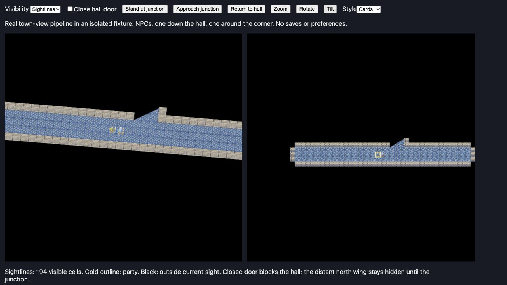

# Continuous town sightlines

Select **Settings / Pause → 3D Settings → Sight: Continuous** (key **4**, then
**Enter**), or **Visuals → Town visibility: Sightlines**. Both controls change the
same remembered preference immediately. The existing
Classic choice retains the original visibility algorithm. The continuous clip
operates in the WebGL map renderer, with cards and model presentations, including
an overhead camera. First-person dungeon visibility and outdoor exploration are
unchanged.

Enhanced sight casts rays to exposed blocker corners and immediately either side
of them, stopping at the first blocking grid edge. The resulting polygon admits
partially visible cells; fully hidden figures are excluded before rendering.
Exposed blocking surfaces remain intact. Walls, closed doors, forest, mountains
and void block sight; low counters remain see-through.

A shared world-space mask clips fragment output across terrain, actor and scenery
cards, models, contact/sun shadows, water/lava effects and window lighting. Model
shadow-depth passes use the same boundary. A 2048-square mask with linear filtering
gives a narrow antialiased edge, independent of camera rotation. Square soft-fog
fades are disabled while continuous town sight is active. Mask uploads happen
only when its polygon or exposed surfaces change. Opening doors changes the map
and recomputes sight on the next viewport update.

`tools/preview-town-sight.html` is an isolated browser fixture using the real
viewport, landscape and map-rendering pipeline. It changes no saves/preferences.
Approach junction demonstrates the diagonal clip; the door checkbox tests hiding
and revealing the far hall. Rotate, Tilt and Style cover cards and solid models.

