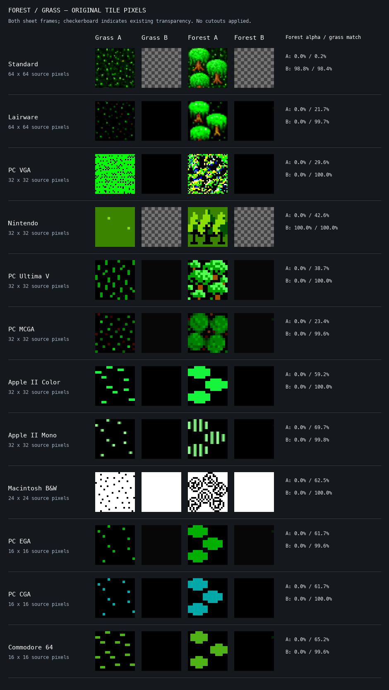

# Forest layering feasibility audit

## Method and evidence

Generated with `python3 web/tools/audit-forests.py` (Pillow). This reads each
set's own tile sheet and optional mask using the game's file precedence;
there is no Standard-art fallback. It crops grass (tile 1) and forest
(tile 3), both sheet cells, scales with nearest-neighbour sampling, and
places existing alpha over a checkerboard. No cutout has been inferred.
`measurements.json` records source hashes, native dimensions, existing
alpha and exact RGB matches with the corresponding grass cell.

The two columns are **sheet frames**, not two working forest animations.
The renderer does not animate forest tiles. Most B cells are blank, and
some retain a few stray pixels. B-cell transparency is therefore not
evidence of usable tree transparency. In all twelve sets, the populated
A forest cell is fully opaque: **none can simply become a transparent
tree card using its existing alpha**.

Exact RGB matches are measurements, not a removal mask. A forest may use
different ground from its grass tile; foliage may share the same palette
colours as the grass. Deleting matching colours would destroy real art.

## Visual review of both cells per set

| Set            | Populated forest cell                                                                                                   | Mask feasibility and disposition                                                                                                                                                  |
| -------------- | ----------------------------------------------------------------------------------------------------------------------- | --------------------------------------------------------------------------------------------------------------------------------------------------------------------------------- |
| Standard       | Several green canopies, trunks, bushes and textured ground fill the tile. B is mostly transparent with residual pixels. | Candidate for hand-reviewed silhouettes around complete trees; ground and low vegetation are ambiguous. Keep flat until a mask is reviewed; do not lift the entire square.        |
| Lairware       | Similar multi-tree composition on dark ground with scattered green marks. B is nearly blank and opaque.                 | Candidate for carefully traced tree silhouettes. Shared green and black details rule out colour-key subtraction. Keep flat pending review.                                        |
| PC VGA         | Dense multicolour forest pattern; no clear isolated trunk/canopy boundary. B is blank.                                  | Ambiguous terrain texture. Keep flat; this audit does not establish a faithful separable tree silhouette.                                                                         |
| Nintendo       | A recognizable branching tree silhouette on an opaque green field. B is transparent and empty.                          | Promising manual silhouette-mask candidate. Background greens must not be removed from matching colours inside the tree. Keep flat pending mask review.                           |
| PC Ultima V    | Multiple green crowns and brown trunks mixed with ground marks. B is blank.                                             | Candidate for per-cluster manual masks retaining original trunk and canopy pixels. Keep flat pending review.                                                                      |
| PC MCGA        | Four rounded crowns and central dark details against dark ground. B is nearly blank.                                    | Candidate for canopy-cluster masks; avoid interpreting ambiguous dark interior pixels as holes. Keep flat pending review.                                                         |
| Apple II Color | Flat bright-green forest clusters on black, sharing the grass palette. B is blank.                                      | Candidate for a cluster-shaped silhouette mask, preserving black enclosed details. It represents a forest cluster, not newly invented individual trees. Keep flat pending review. |
| Apple II Mono  | Striped light-green clusters on black. B is nearly blank.                                                               | Candidate for cluster masks preserving internal black stripes; a bright-pixel-only mask would alter the art. Keep flat pending review.                                            |
| Macintosh B&W  | Dense outlined/hatched clusters on white; white belongs to both ground and canopy interiors. B is blank white.          | Ambiguous boundary in this evidence. Keep flat until a separately reviewed silhouette can distinguish intentional white interior pixels from ground.                              |
| PC EGA         | Simple green forest clusters on black. B is nearly blank.                                                               | Candidate for cluster masks, not recolouring or newly drawn trunks. Keep flat pending review.                                                                                     |
| PC CGA         | Simple cyan forest clusters on black. B is blank.                                                                       | Candidate for cluster masks retaining cyan and any enclosed black. Keep flat pending review.                                                                                      |
| Commodore 64   | Simple olive-green clusters on black. B is nearly blank.                                                                | Candidate for cluster masks retaining the original palette. Keep flat pending review.                                                                                             |

## Decision

All forests remain flat in this increment. No production mask, automatic
background removal, new sprite, or reconstructed layer was added.

A later Layered mode may enable only masks reviewed against the original
pixels on light, dark and checkerboard backgrounds, at all supported
camera angles. Rejection or missing masks must preserve the original flat
tile. PC VGA and Macintosh B&W specifically need additional evidence before
proposing any cutout. Never borrow another tile set's trees.

Stepped mountains and recessed water remain later geometry work. New side
art, repainted foliage and reconstructed hidden portions belong to a
separate future Expanded-art mode.
