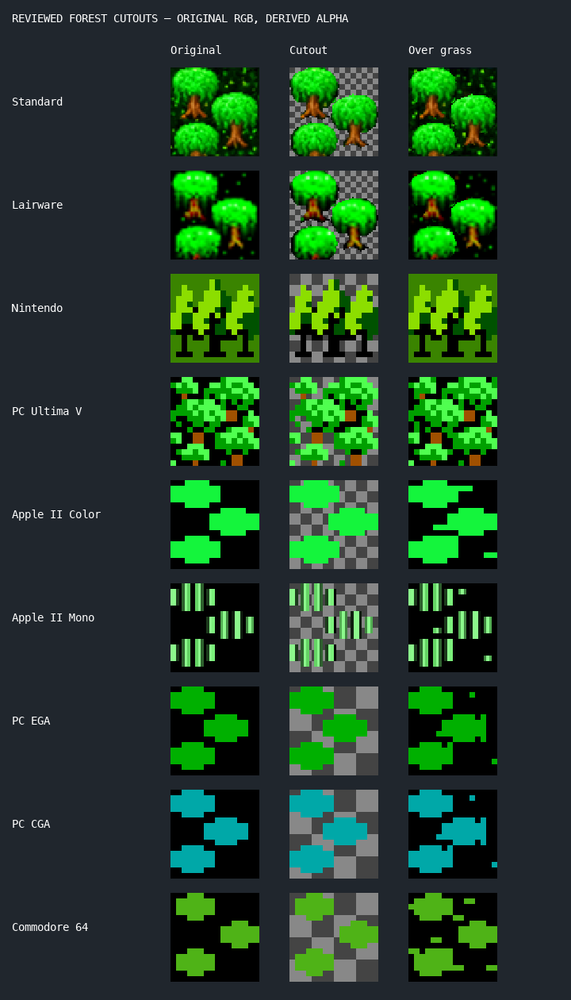
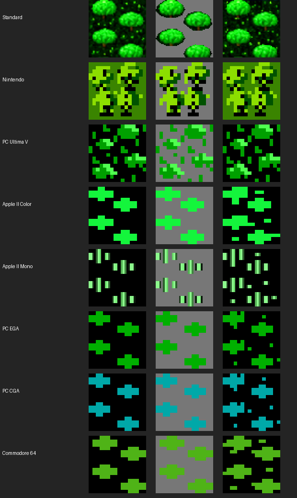
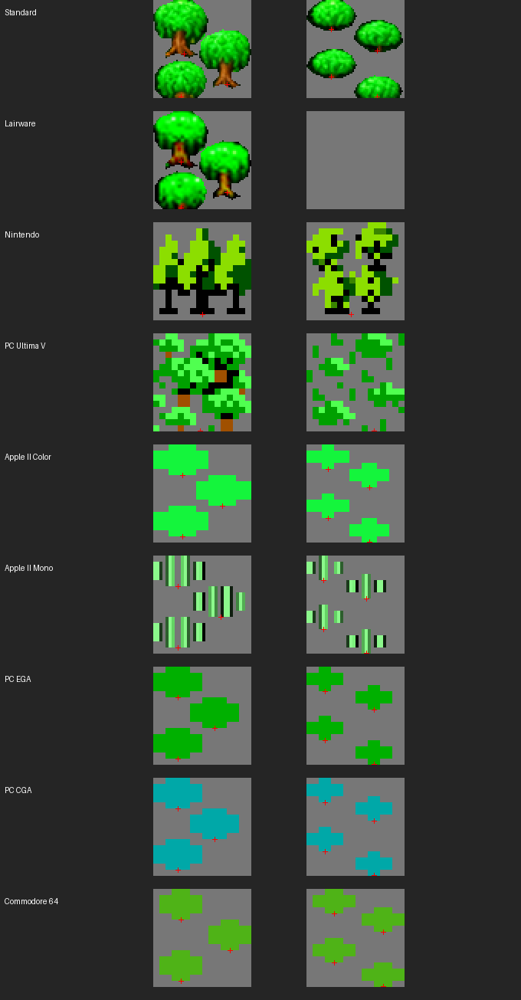

# Reviewed forest cards

Enable **Settings / Pause → 3D Settings → Trees: Cards** (G). It defaults off;
turning it on is an individual Custom presentation override. A straight-down
view uses the original forest tile. Angled views use the selected set’s grass
under a separate transparent tree card. Trees, brush and characters overlap by depth: nearer foliage can cover the
party while transparent gaps remain clear. Mountains and walls occlude them. Only already-visible scenery
is used, including contact shadows when enabled.

Supported: Standard, Lairware, Nintendo, PC Ultima V, Apple II Color,
Apple II Mono, PC EGA, PC CGA, and Commodore 64.
PC VGA and Macintosh B&W remain flat because their foreground/background
boundaries are ambiguous. PC MCGA remains flat pending a separate mask review.
There is no fallback to another set’s tree artwork.

`python3 web/tools/prepare-forest-cards.py` regenerates the assets and this
comparison. Standard and Lairware use traced silhouettes; the other supported
sets use individually reviewed edge-connected exterior colours. Enclosed
matching-colour details are retained. These decisions are baked into separate
`*-ForestCard.png` files, never applied as a runtime segmentation algorithm.

All retained RGB pixels come directly from the original populated A frame;
only alpha changes. No trunks, foliage, or missing pixels are reconstructed.
The original sheets are unchanged. The generator asserts retained RGB equality
and useful transparency. `manifest.json` records source and output SHA-256 hashes,
mask decisions, dimensions, and retained pixel counts. Forest B cells are not
used, matching the game’s existing non-animated forest rendering.

## Individual Standard trees

Standard uses `Standard-TreeCards.png`: three independent 64×64 transparent
frames, one for each traced silhouette. Their native pixel bases are (20,35),
(48,55), and (18,63), with the origin at the source tile’s top left. Each base
maps to that position within the ground tile, and stays fixed as the camera
rotates or tilts. Each card retains the source pixel scale and colours. No
missing foliage is filled in; the bottom tree remains clipped at the original
tile boundary. Other sets keep their reviewed cluster cards.

Each tree gets a smaller contact shadow at its own base. Nearer foliage can
occlude characters. Straight-down views continue to use the untouched original tile.

## Brush cards

The same **Trees/brush: Cards** setting also raises brush. Standard has four
independent clumps anchored at native pixels (16,19), (46,33), (16,50), and
(46,63). Original colours and scale remain intact, including the clipped
bottom clump. Smaller shadows sit at their individual bases.

Nintendo, PC Ultima V, Apple II Color, Apple II Mono, PC EGA, PC CGA, and
Commodore 64 use reviewed cluster masks. Lairware, PC MCGA, PC VGA and
Macintosh B&W brush remain flat pending separate mask review. Forest and brush
support are independent; no unsupported brush is replaced by grass.

Regenerate with `python3 web/tools/prepare-brush-cards.py`. The Standard
silhouettes are traced; the seven cluster masks remove only their reviewed
edge-connected exterior colour, preserving enclosed details. Source RGB
preservation is asserted, and source/output hashes are in `brush-manifest.json`.
No original sheet is changed. Overhead views retain the original brush tiles;
nearer foliage can occlude characters, and foreground cubes still occlude both.

## Per-set ground anchors

`tools/prepare-vegetation-layouts.py` builds an eight-slot per-set vegetation
atlas and generates `src/ui/vegetationLayouts.ts`. Anchors are expressed in a
64-unit tile coordinate system but measured from each set’s own native pixels.
Standard retains its reviewed tree/brush anchors. Lairware now has three
separate tree cards. Apple II Color, Apple II Mono, PC EGA, PC CGA and
Commodore 64 have three forest cards and four brush cards. The disconnected
stripes in Apple II Mono remain grouped as their original plant shapes.

Native alpha is partitioned without deleting or inventing retained pixels;
recomposition assertions verify identical alpha and retained RGB. Ground bases
for the simpler silhouettes are the centre of their lowest occupied row at
its bottom edge. Both card placement and sun/contact shadows use these anchors.
Every card keeps a full tile coordinate frame, so overhead reconstruction and
native pixel scale remain exact. Full overhead rendering still uses original tiles.

Nintendo and PC Ultima V contain connected vegetation, so they retain cluster
cards, now anchored at their own source contact point rather than the tile centre.
Ambiguous/unreviewed masks still fall back flat. Lairware brush remains flat.
`vegetation-layouts.json` records atlas hashes and layouts. No source sheets or
previous reviewed cutouts are overwritten by this step.
