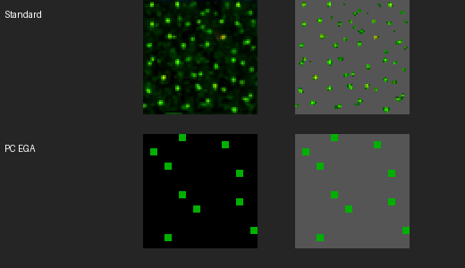

# Optional grass depth

Enable **3D Settings → Grass depth**. This first increment supports Standard
and PC EGA; other tile sets keep their flat grass. It defaults off. The original
ground tile remains underneath the cards.

`python3 web/tools/prepare-grass-cards.py` generates separate atlases and
`src/ui/grassLayouts.ts`. Standard uses 53 reviewed bright marks (native green
at least 85); EGA uses its ten isolated grass-green pixels. Retained RGB comes
directly from the native sheet. Only the selected marks are copied; there is
no recolouring, reconstruction, or runtime segmentation. Source and output
hashes are in `manifest.json`. Original sheets are unchanged.

Cards retain native width/height and are anchored at the bottom of their own
mark. Explored grass across the landscape is submitted only where it intersects the
camera view, in one instanced draw with a 32768-card budget. If the budget is
reached, marks are thinned across all visible tiles instead of cutting off a
rectangular region. Camera motion updates this selection without needing a
game turn. Unknown tiles never supply grass. They fade between roughly 5–26° tilt and 24–48 screen pixels
per tile. Overhead and distant views have no grass cards. They stay behind
actors, test against cube/building depth, write no depth, and cast no individual
contact or sun shadows. Day/night colours affect them with the supporting ground.

Open `/tools/preview-grass-depth.html` on the development server for a preview
that reads no game save. It compares Standard/EGA, On/Off, overhead/angled,
zoomed-out views, and quarter-turn WASD mappings without advancing a game.
